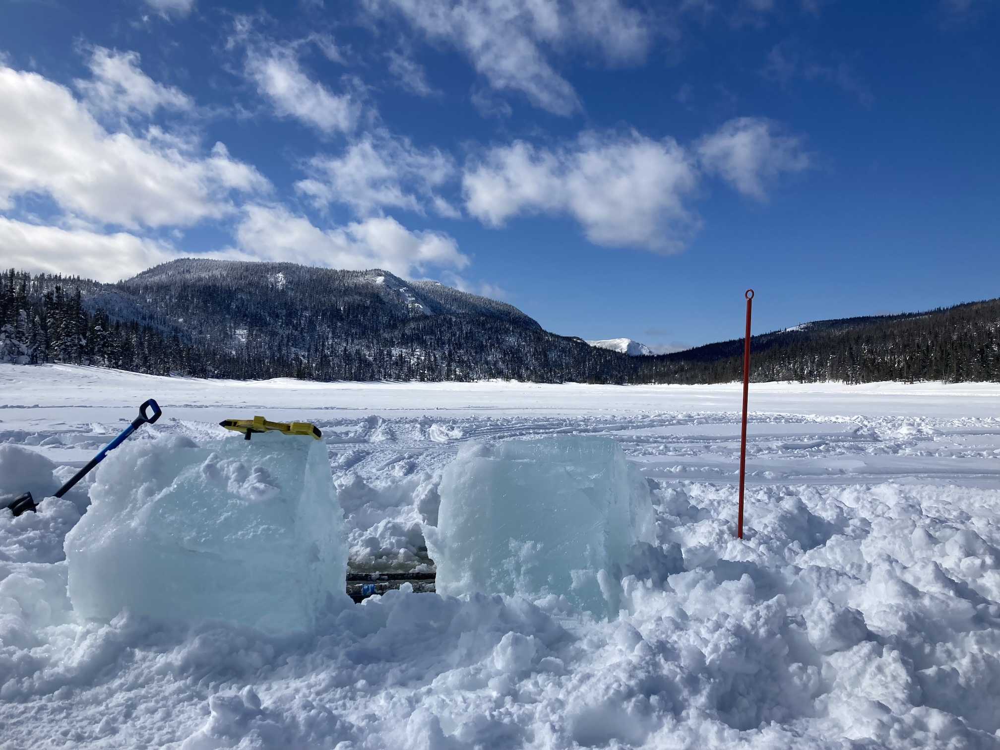
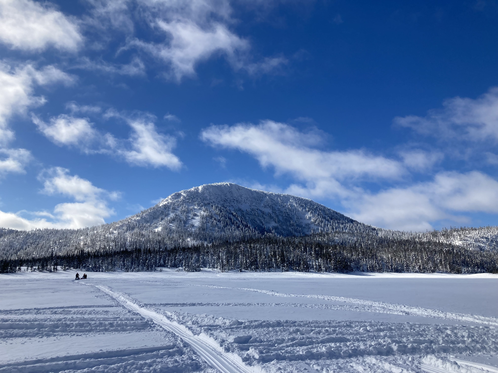
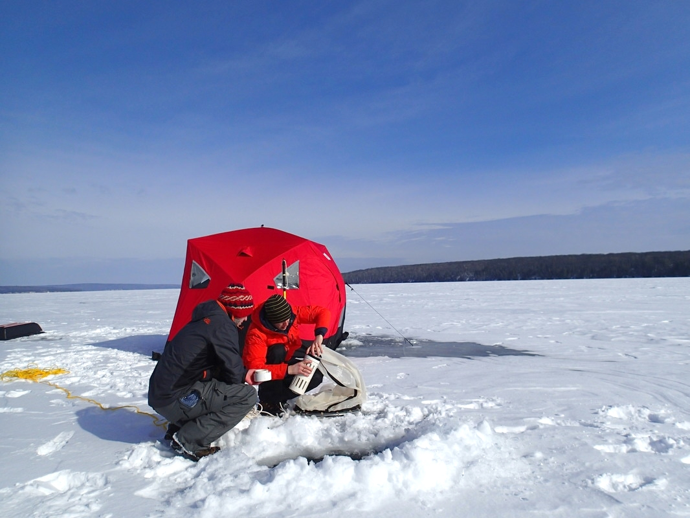
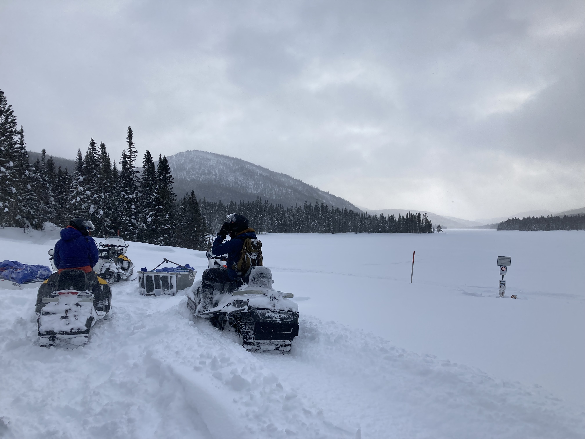
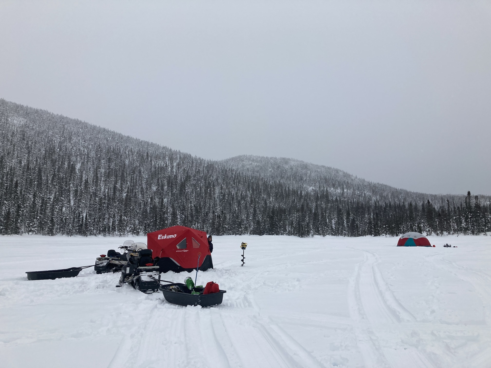

*Join fellow students, postdocs, and experienced instructors at Trout Lake Station in northern Wisconsin for a comprehensive winter limnology workshop. Gain hands-on experience in ice safety and rescue, winter field operations, and sensor technology for under-ice observations. Explore team science and expand your professional network.*

## **General Overview:**

**Location**: University of Wisconsin [Trout Lake Field Station]( https://limnology.wisc.edu/trout-lake-station-overview/)

**Dates**: February 15-19, 2027 (with February 14 and 20 as travel days).

**Accommodations & meals**: Accommodations in dorm-style cabins at the field station. Meals will be provided.

### About

::: columns
::: {.column width="50%"}

:::
::: {.column width="3%"}
:::
::: {.column width="47%"}
Winter conditions pose unique challenges to limnological research, contributing to a “winter knowledge gap” in our understanding of seasonally freezing lakes. Unfortunately, few of us are trained for the unique challenges of limnological sampling on frozen lakes, including ice safety, operating standard limnological gear in subzero temperatures, collecting samples from under snow and ice cover, and even dressing for the cold, windy, and wet conditions winter limnologists routinely encounter. The Limnology Winter School offers early-career aquatic scientists hands-on experience in safe and effective winter research.
:::
:::
::: columns
::: {.column width="47%"}
This NSF-supported workshop will include practical sessions on lake ice safety and rescue, planning and logistics for winter field operations, winter sampling and measurements of biological, chemical, and physical conditions, deployment of high-frequency sensors, and working with sensor data from ice-covered lakes. Ice safety and rescue training will be led by professional ice rescue instructors. Participants who complete the training will receive a certificate of completion in ice safety and rescue. Participants will also join working group discussions on emerging topics in limnology and team science and explore opportunities for collaborative projects with workshop leaders and fellow participants. Read about our 2024 Winter School in the Limnology and Oceanography Bulletin: [“Winter Limnology on the Rise.”](https://aslopubs.onlinelibrary.wiley.com/doi/10.1002/lob.10643)
:::
::: {.column width="3%"}
:::
::: {.column width="50%"}

:::
:::

::: columns
::: {.column width="50%"}

:::
::: {.column width="3%"}
:::
::: {.column width ="47%"}
Participants in the Limnology Winter School will join a team of experienced winter limnologists and outreach specialists at UW-Madison's scenic Trout Lake Biological Station for 4 days of hands-on field work and discussions. Topics will include:

-   Planning and executing winter field operations

-   Ice safety and rescue

-   Collecting standard limnological data and samples under ice

-   Planning and conducting public outreach during winter

-   Discussion of key open questions and novel hypotheses for winter limnology

-   Best practices in Team Science
:::
:::

Participation is open to students and postdocs. Training, accommodations (shared cabins), and meals are provided at no cost to participants. Travel support of up to $500 is available for U.S.-based participants, based on anticipated travel costs and financial need. Participants are responsible for costs exceeding their travel award and are encouraged to seek supplementary institutional support.

## Workshop Details

### Expectations and Cost Offsets
::: columns
::: {.column width="45%"}
#### Participants are expected to:

- Be fully engaged in workshop events listed in the agenda, for the full workshop, and able to set aside regular work distractions

- Continue to engage collaboratively in writing products/manuscripts after the workshop ends

- Abide by the workshop code of conduct

- Complete some pre-workshop activities prior to arriving
:::

::: {.column width="5%"}
:::

::: {.column width="50%"}

:::
:::

#### Cost Offsets

Travel support of up to $500 is available for U.S.-based participants, based on anticipated travel costs and financial need. Participants are responsible for costs exceeding their travel award and are encouraged to seek supplementary institutional support.

### Preliminary program
::: columns
::: {.column width="50%"}

:::

::: {.column width="5%"}
:::

::: {.column width="5%"}
:::

::: {.column width="50%"}

:::
:::

::: columns
::: {.column width="50%"}

:::

::: {.column width="5%"}
:::

:::

## Application and Registration Information:

Spaces in the workshop are limited. Applicants will be prioritized based on interest in participation in follow up sampling through the Winter Research Network, applicant career stage, and self-described status as members of groups historically underrepresented in limnology.

Applications are due on ***November 30th, 2026***. Successful applicants will be contacted by ***December 15, 2026***.

# Application opens soon...

#### For Questions contact Ted Ozersky (tozersky@d.umn.edu)

#### **Workshop support:**
This workshop is supported by NSF project # 2306885 “Advancing a comprehensive model of year-round ecosystem function in seasonally frozen lakes through networked science”.

